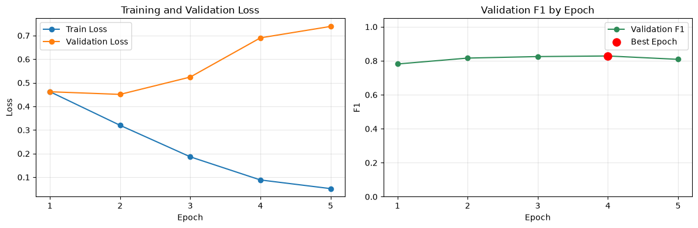
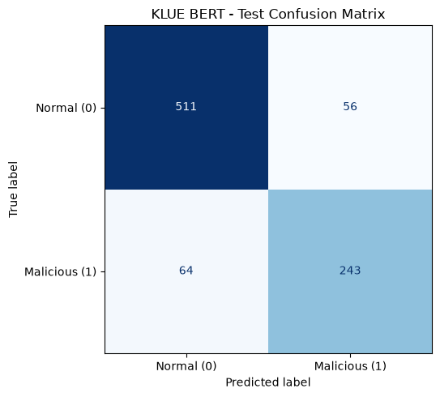

# 한국어 악성 댓글 탐지 | Transformer Mini Project

한국어 사전학습 Transformer 모델 **KLUE BERT**를 미세조정하여 온라인 댓글을 **일반 댓글(0)**과 **악성 댓글(1)**로 분류하는 미니 프로젝트입니다. 데이터 전처리부터 학습, 검증, 테스트 평가, 시각화, 새 댓글 예측까지 Jupyter Notebook에서 진행합니다.

## 프로젝트 목표

- 한국어 댓글에 포함된 욕설·비하 표현을 문장 단위로 탐지합니다.
- 댓글 하나에 하나의 정답을 부여하는 **이진 분류**를 구현합니다.
- 일반 댓글을 악성으로 판단하는 오탐과 악성 댓글을 놓치는 누락을 분석합니다.

## 사용 모델과 기술

| 구분 | 내용 |
|---|---|
| 사전학습 모델 | [`klue/bert-base`](https://huggingface.co/klue/bert-base), 한국어 BERT |
| 모델 구성 | `AutoModelForSequenceClassification`, 출력 클래스 2개 |
| 분류 설정 | `single_label_classification` |
| 라벨 | `0`: 일반 댓글 / `1`: 악성 댓글 |
| 손실 함수 | Cross-Entropy Loss, 정수형 `torch.long` 라벨 |
| 예측 방식 | softmax 악성 점수가 0.5 이상이면 악성으로 분류 |
| 학습 | PyTorch, Hugging Face Transformers |
| 데이터 처리 | Hugging Face Datasets, pandas, NumPy |
| 평가 / 시각화 | scikit-learn / Matplotlib |
| 환경 | Python 3.12, Jupyter Notebook / VS Code |
| 장치 선택 | CUDA → Apple Silicon MPS → CPU |

여러 독립적인 라벨을 동시에 예측하는 멀티라벨 분류와 달리, 댓글마다 일반 또는 악성 중 하나의 클래스를 선택합니다. 사전학습된 BERT에 두 클래스 분류 헤드를 추가한 뒤 댓글 데이터로 전체 모델을 미세조정합니다.

## 데이터셋

출처: [2runo/Curse-detection-data](https://github.com/2runo/Curse-detection-data)

커뮤니티 댓글 **5,825개**에 욕설 여부를 기록한 공개 한국어 데이터셋입니다. 한 줄마다 `댓글|라벨` 형식이며, 원본의 분류 기준에는 욕설뿐 아니라 비하·차별 등도 포함됩니다.

1. 마지막 `|`를 기준으로 분리하여 댓글 내부의 구분자를 보존합니다.
2. 빈 댓글과 라벨 형식을 확인합니다.
3. 동일 댓글에 상충하는 라벨이 있으면 제외합니다. 이번 데이터에는 해당 행이 없었습니다.
4. 중복 댓글 4개를 제거하여 **5,821개**를 사용합니다.
5. 클래스 비율을 유지하는 층화 분할로 학습·검증·테스트를 약 **70 : 15 : 15**로 나눕니다.

| 구분 | 댓글 수 | 역할 |
|---|---:|---|
| Train | 4,074 | 모델 가중치 학습 |
| Validation | 873 | 최적 에폭 선택 |
| Test | 874 | 최종 성능 평가 |

일반 댓글 3,779개, 악성 댓글 2,042개를 사용합니다. 각 split의 악성 비율은 약 35.1%입니다. 동일 댓글이 다른 split에 포함되지 않도록 확인하며, 정수 개수로 나누므로 비율에는 반올림 오차가 있습니다.

원본 데이터는 중복 업로드하지 않고 노트북 실행 시 출처 저장소를 복제합니다. 데이터 라이선스는 [원본 LICENSE](https://github.com/2runo/Curse-detection-data/blob/master/LICENSE)를 참고하세요.

## 학습 과정과 설정

```text
데이터 읽기·중복 제거 → 층화 분할 → KLUE BERT 토큰화
→ TensorDataset / DataLoader → AdamW 학습 → 매 에폭 검증
→ 검증 F1이 가장 높은 모델 저장 → 테스트 평가 → 새 댓글 예측
```

| 설정 | 값 |
|---|---|
| 최대 입력 길이 | 128토큰, 특수 토큰 포함 |
| 배치 크기 / 에폭 | 8 / 5 |
| 학습률 | `2e-5` = 0.00002 |
| 옵티마이저 | AdamW, weight decay 0.01 |
| 스케줄러 | 전체 step의 10% warmup 후 linear decay |
| Gradient clipping | 최대 norm 1.0 |
| Seed | 42 |
| 최적 모델 기준 | 검증 데이터의 악성 클래스 F1 |

짧은 댓글은 padding으로 길이를 맞추고 긴 댓글은 자릅니다. 학습 데이터만 순서를 섞으며, 검증·테스트에서는 가중치를 업데이트하지 않습니다. Mac 노트북 환경을 고려하여 `num_workers=0`을 사용하고 `pin_memory`는 CUDA에서만 활성화합니다.

## 실험 결과

프로젝트에 저장된 `test_metrics.json`과 `experiment.json`의 결과입니다. **5에폭 중 4에폭** 모델의 검증 F1이 가장 높아 해당 모델을 테스트했습니다.

| 지표 | 값 |
|---|---:|
| 최적 검증 F1 | 0.8284 |
| 테스트 Accuracy | 0.8627 |
| 테스트 Precision | 0.8127 |
| 테스트 Recall | 0.7915 |
| 테스트 F1 | 0.8020 |
| 테스트 ROC AUC | 0.9132 |
| 테스트 Loss | 0.8097 |

Precision, Recall, F1은 **악성 클래스(1)** 기준입니다. 단일 데이터 분할의 결과이며, 새로운 커뮤니티에서도 같은 성능을 보장하지 않습니다. 재학습 시 장치와 라이브러리의 차이로 결과가 달라질 수 있습니다.

### 학습 곡선



학습 loss는 감소하지만 후반부 검증 loss는 증가합니다. 과적합의 징후를 살펴볼 수 있으며, 이 실험에서는 검증 F1을 기준으로 최적 모델을 선택했습니다.

### 테스트 혼동 행렬



- 세로축: 실제 정답 / 가로축: 모델 예측
- 오른쪽 위: 일반 댓글을 악성으로 판단한 **오탐**
- 왼쪽 아래: 악성 댓글을 일반으로 판단한 **누락**

노트북에서는 분류 보고서와 오분류 댓글 10개도 확인할 수 있습니다. 오분류 표는 전체 테스트 결과에서 오류 사례만 추린 것입니다.

## 실행 방법

Git과 Python 3.12가 필요합니다. 아래는 macOS/Linux 기준입니다.

```bash
git clone https://github.com/JuYoung710/Transformer_Malicious-comment-detection.git
cd Transformer_Malicious-comment-detection
python3 -m venv .venv
source .venv/bin/activate
python -m pip install -r requirements.txt
python -m ipykernel install --user --name malicious-comment --display-name "Python (malicious-comment)"
```

1. VS Code에서 저장소 폴더를 열고 Python·Jupyter 확장을 준비합니다.
2. `악성 댓글 탐지.ipynb`를 열고 커널로 `Python (malicious-comment)` 또는 `.venv`를 선택합니다.
3. 노트북 작업 디렉터리가 저장소 루트인지 확인하고 셀을 위에서부터 순서대로 실행합니다.
4. 최초 실행 시 데이터셋과 사전학습 모델을 내려받으므로 인터넷 연결이 필요합니다.

`requirements.txt`는 실험 환경의 주요 패키지 버전을 기록합니다. 메모리가 부족하면 `BATCH_SIZE`를 4로 낮출 수 있습니다.

**학습한 가중치와 가상환경은 포함하지 않았습니다.** 테스트·예측 셀 실행 전에 학습하여 `model/klue_bert_curse_binary/`에 모델을 생성해야 합니다. 저장된 CSV/JSON은 이전 실험 기록이며 모델 가중치를 대신하지 않습니다.

## 새 댓글 예측

학습과 최적 모델 재로딩 셀 실행 후 사용합니다.

```python
prediction("확인할 댓글을 입력하세요.")
```

| 반환 항목 | 의미 |
|---|---|
| `document` | 입력 댓글 |
| `label_id` | 예측 클래스 0 또는 1 |
| `label` | 일반 댓글 또는 악성 댓글 |
| `malicious_probability` | softmax 악성 클래스 점수 |

악성 점수가 0.5 이상이면 악성으로 판단합니다. 실제 악성 확률로 보정된 값은 아닙니다. 임계값 조정 시 오탐과 누락의 균형이 달라지므로, 테스트 데이터가 아닌 검증 데이터에서 비교해야 합니다.

## 파일 구성

```text
Transformer_Malicious-comment-detection/
├── 악성 댓글 탐지.ipynb
├── README.md
├── requirements.txt
├── .gitignore
├── assets/
│   ├── training_curves.png
│   └── confusion_matrix.png
└── model/klue_bert_curse_binary/
    ├── experiment.json
    ├── training_history.csv
    ├── test_metrics.json
    └── test_predictions.csv
```

데이터 폴더, 가상환경, 모델 가중치는 `.gitignore`로 제외합니다. 노트북 코드와 실행 결과는 로컬 프로젝트에서 그대로 복사했으며, 참고용 `7_PLM.ipynb`는 포함하지 않습니다.

## 한계와 개선 방향

- 은어·비꼼·간접적인 비하와 문맥에 의존하는 표현을 놓칠 수 있습니다.
- 수동 라벨과 모델 판단이 다를 수 있어 오류 사례 검토가 필요합니다.
- 소규모 데이터셋이므로 다양한 서비스·커뮤니티에 바로 일반화하기 어렵습니다.
- 다양한 댓글 추가, 검증 데이터 기반 임계값 조정, 다른 한국어 모델 및 여러 seed 비교를 통해 개선할 수 있습니다.

## 참고 자료

- [KLUE BERT 모델 카드](https://huggingface.co/klue/bert-base): 한국어 사전학습 모델, 라이선스 CC BY-SA 4.0
- [Curse-detection-data](https://github.com/2runo/Curse-detection-data): 데이터 및 라벨 기준
- [Hugging Face Transformers](https://huggingface.co/docs/transformers/index)
- [PyTorch](https://pytorch.org/docs/stable/index.html)
- [scikit-learn](https://scikit-learn.org/stable/)
